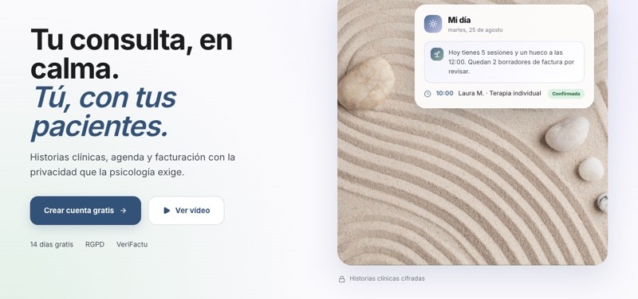
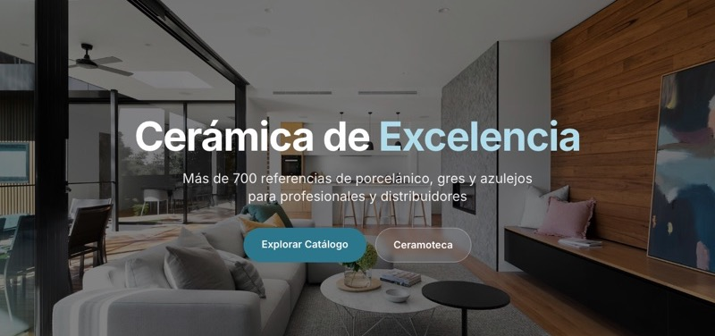
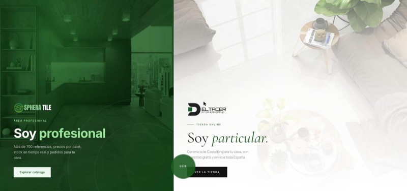
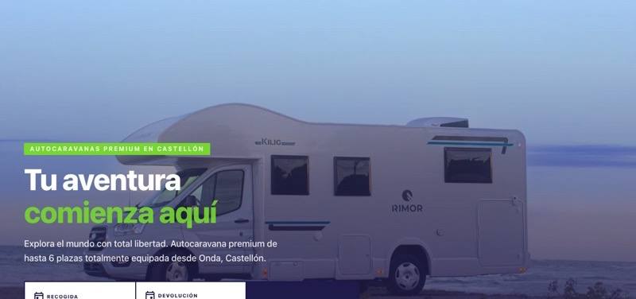
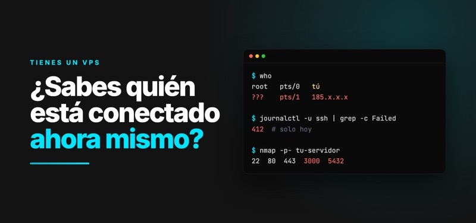

## Sobre mí

Soy CEO de [LumicaTech](https://lumicatech.es), en Vila-real. Construyo productos SaaS propios, ERP y CRM a medida, webs y sitios WordPress, y herramientas de IA conectadas a los datos reales de cada empresa. Y me ocupo de que todo eso corra en servidores seguros.

## Qué hago

## Proyectos destacados

<table>
<tr>
<td width="50%" valign="top">

<h3><a href="https://kheo.es">KHEO</a></h3>
SaaS para psicólogos y centros: historias clínicas cifradas, agenda, reserva online, facturación VeriFactu y un asistente de IA para notas de sesión.
  <code>Next.js</code> <code>Prisma</code> <code>Stripe</code> <code>Claude</code>
</td>
<td width="50%" valign="top">

<h3><a href="https://lumiware.lumicatech.es">LumiWare</a></h3>
SaaS de gestión de almacén y venta B2B para el sector cerámico: stock en tiempo real, catálogos, pedidos, almacén en 3D y operaciones accesibles para agentes de IA por MCP.
  <code>Next.js</code> <code>Three.js</code> <code>pgvector</code> <code>MCP</code>
</td>
</tr>
<tr>
<td width="50%" valign="top">

<h3><a href="https://spheratile.es">Sphera Tile</a></h3>
Cerámica con dos caminos: tienda online para particulares y <a href="https://app.spheratile.es">área profesional</a> con stock en tiempo real.
  <code>Next.js</code> <code>Three.js</code> <code>Prisma</code> <code>PostgreSQL</code>
</td>
<td width="50%" valign="top">

<h3><a href="https://deltacaravan.es">Delta Caravan</a></h3>
Alquiler de autocaravanas con reservas online y panel de administración.
  <code>Next.js</code> <code>Prisma</code> <code>Supabase</code>
</td>
</tr>
</table>

## Ciberseguridad

<table>
<tr>
<td width="50%" valign="top">

</td>
<td width="50%" valign="top">
<h3><a href="https://www.linkedin.com/feed/update/urn:li:activity:7515068760924475392/">Securiza tu VPS con tu IA</a></h3>
Guía de 29 páginas para blindar un servidor paso a paso, con los prompts listos para copiar. Después de aplicarla en mis servidores, de 65.535 puertos solo responden 3, y ninguno acepta contraseñas.
  <code>SSH</code> <code>Cortafuegos</code> <code>Docker</code> <code>Cloudflare</code> <code>fail2ban</code>
</td>
</tr>
</table>

**Mis servidores** es mi monitor para la barra de menús del Mac: un escudo verde o ámbar que muestra quién está conectado, los intentos de entrada de la última hora, los puertos abiertos y si se han hecho las copias.

## Más proyectos

| Proyecto | Qué es | Tecnología |
| --- | --- | --- |
| **ERP industrial a medida** | ERP y SAT para una empresa de instalaciones: presupuestos, partes con firma digital, facturación VeriFactu, proyectos y stock | NestJS, Next.js, PostgreSQL, Redis |
| **CRM Lumicatech** | CRM multi-tenant propio con contactos, pipeline de ventas y comunicación, ampliable con automatización y pagos | NestJS, Next.js, PostgreSQL, Redis |
| **[PlantControl OS](https://plantcontrol.lumicawebdesign.com)** | Gestión de tareas para plantas industriales, con demo pública | Next.js, Prisma |
| **Bravio** | Gestión y reservas para barberías, derivado de KHEO | Next.js, Prisma, Stripe |
| **Asistente de voz local** | Asistente para macOS que consulta mis herramientas y pide aprobación antes de modificar nada | Tauri, React, Whisper |

## Código abierto

- **[WP API Codeia](https://github.com/JoseMas68/wp-api-codeia):** convierte WordPress en una API headless versionada, con permisos granulares y OpenAPI 3.0.
- **[PageWhisper](https://github.com/JoseMas68/pagewhisper):** extensión de Chrome que extrae componentes web y los convierte en código reutilizable con IA.
- **[Plan FIRST](https://github.com/JoseMas68/plan-first):** generador de planes de running en un solo archivo y sin dependencias.

## Tecnologías

## Actividad

## Contacto

Si tienes un proyecto en mente, escríbeme por [LinkedIn](https://www.linkedin.com/in/jose-mas-448393379/) o desde [lumicatech.es](https://lumicatech.es). También puedes leer mi [guía para securizar un VPS](https://www.linkedin.com/feed/update/urn:li:activity:7515068760924475392/).
